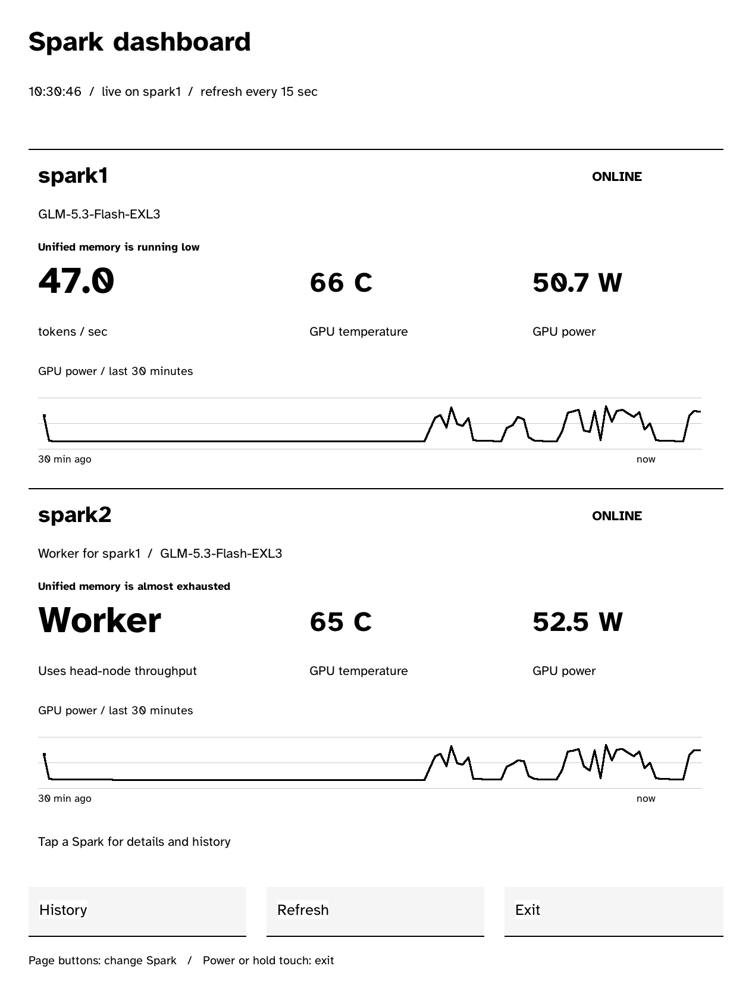
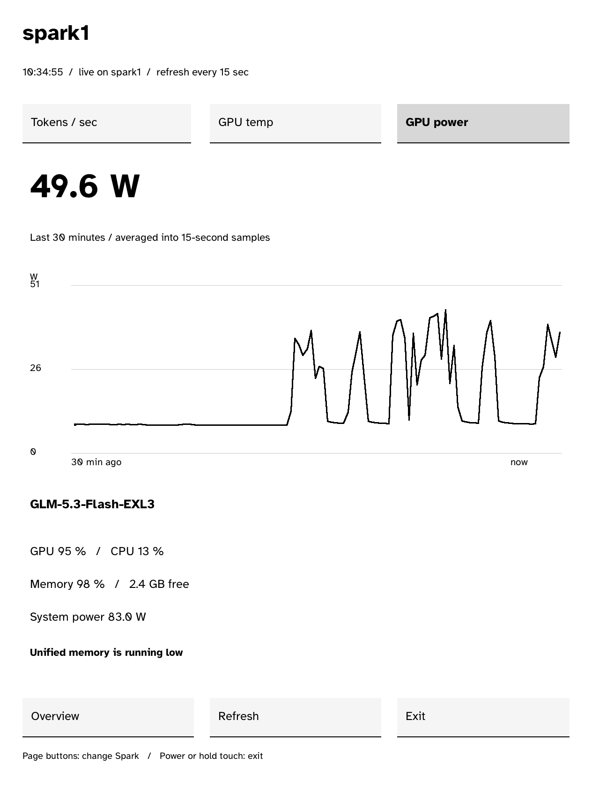

# Kobo Spark

A native e-ink dashboard for NVIDIA DGX Spark machines, built for the **Kobo Libra
Colour**. Keep model throughput, GPU temperature, power, and history beside you
without opening another browser window.

Inspired by **[MiaAI-Lab sparkDash](https://github.com/MiaAI-Lab/sparkDash)** and
powered by its monitoring API. Kobo Spark is a standalone C client; sparkDash
continues running on your server.

<p align="center">
  
  
</p>

*Actual framebuffer captures from the working app on a Kobo Libra Colour.*

## What it shows

- Live generation tokens/sec, GPU temperature, and GPU power.
- A two-machine overview and individual pages for up to four machines.
- Selectable temperature, power, and token-rate charts over a 30-minute window.
- Model names, GPU/CPU usage, unified memory, system power, and health alerts.
- Automatic refresh about every 15 seconds, with a manual Refresh button.
- Last readings marked **STALE** when a request fails, and `--` for missing values.

Temperature and power history come from sparkDash, averaged into 15-second
buckets. Token-rate history is recorded by the Kobo while the app runs and saved
across launches; gaps remain visible while it is closed or disconnected. Worker
nodes identify their head node instead of counting the head's throughput twice.

## Requirements

- Kobo Libra Colour, device ID **390**, in portrait orientation. The app was
  developed and tested on firmware **4.45.23697**; other models are not supported.
- [NickelMenu](https://pgaskin.net/NickelMenu/) installed on the reader.
- A running [sparkDash](https://github.com/MiaAI-Lab/sparkDash) instance whose API
  is reachable from the Kobo's Wi-Fi network.
- Docker, Git, Make, Python **3.12+**, and curl to build. Apple Silicon works
  through Docker's Linux/amd64 emulation (including OrbStack).
- A host C compiler and libcurl development files for the tests.

The client currently uses sparkDash's **open API mode**. Token-protected API mode
needs client authentication support added. HTTP works for a LAN service; HTTPS
uses certificate and hostname verification. Prefer your server's reachable LAN
IP address if the Kobo cannot resolve its hostname.

## Build and install

```sh
git clone https://github.com/palmsnipe/kobo-spark.git
cd kobo-spark
cp device/dashboard.conf.example device/dashboard.conf
```

Edit `device/dashboard.conf` to contain your sparkDash base URL on one line,
for example:

```text
http://192.168.1.100:5555
```

Then build:

```sh
make check
make build
```

The first build downloads pinned FBInk, curl, and Mbed TLS sources and compiles
them using [NickelTC](https://github.com/pgaskin/NickelTC). The Docker image is
pinned by digest, source archives are checked with SHA-256, and subsequent builds
reuse the compiled dependencies. Output is `dist/kobo-spark/`.

Connect the Kobo by USB and tap **Connect**. With NickelMenu already installed:

```sh
# macOS default: /Volumes/KOBOeReader
python3 scripts/install-usb.py --dry-run
python3 scripts/install-usb.py

# Linux, or a different mount point:
python3 scripts/install-usb.py --volume /media/you/KOBOeReader
```

The installer verifies copied files and adds **NickelMenu → Kobo Spark**. It
installs only under `.adds/kobo-spark/` and its own NickelMenu configuration;
it preserves existing app settings, logs, and history on updates. It does not
install firmware, enable SSH, or require private backup files.

Safely eject and unplug the reader. Enable Wi-Fi in Kobo's normal settings, then
choose **NickelMenu → Kobo Spark**.

To change the server after installation, edit
`.adds/kobo-spark/dashboard.conf` on the mounted reader. Updating the app keeps
that file. Keep a backup of your reader before installing native software.

## Controls

| Control | Action |
| --- | --- |
| Tap a machine or **History** | Open a detail page |
| **Tokens / sec**, **GPU temp**, **GPU power** | Select the history chart |
| Page buttons | Cycle between overview and machine pages |
| **Refresh** | Fetch fresh readings immediately |
| **Overview** | Return to the two-machine overview |
| **Exit**, power-button release, or a 1.2-second touch-and-release | Return to Kobo's stock reader |

The dashboard stays awake until you exit, so continuous monitoring uses more
battery than a sleeping reader. The launcher stops Nickel to release its
exclusive input grabs and restarts it on exit. A separate heartbeat guard
recovers the stock reader if the app hangs. Kobo Wi-Fi may disconnect when the
stock reader restarts; enable it again before the next launch. Keep the reader
in its starting portrait orientation; live rotation is not implemented.

## Development

```sh
make check           # Parser, history, offline/stale handling, USB installer
make check-sanitize  # Address and undefined-behaviour sanitizers
make check-live SPARKDASH_URL=http://192.168.1.100:5555
```

`src/dashboard.c` contains the FBInk interface, chart rendering and input loop.
`src/dashboard_data.c` contains the bounded JSON reader, API client, background
worker and rolling token history. The UI remains responsive during requests;
responses are limited to 256 KiB and refresh jobs have a 25-second deadline.

The client sends GET requests to `/api/sparks`, `/api/sparks/:id/metrics`, and
`/api/sparks/:id/gpu-history?windowMs=1800000`. It never changes the server's models
or monitoring settings.

For diagnostics, the installed executable supports `--version`,
`--probe-dashboard` (fetch readings without taking over the screen), `--config
PATH`, `--run-seconds N`, `--page N`, `--metric N`, and `--capture PATH` (raw
framebuffer output). Runtime logs are `.adds/kobo-spark/app.log` and `reader.log`.

The original on-device implementation was checked with live readings from two
Sparks, touch controls, chart tabs, page buttons, refresh and exit. A frozen-app
recovery test confirmed the stock reader restarted and the wake lease was
released. This standalone repository separates that dashboard from the earlier
Hello Kobo development demo.

## Credits and licence

Thanks to **[MiaAI-Lab and the sparkDash contributors](https://github.com/MiaAI-Lab/sparkDash)**
for the monitoring backend and the dashboard that inspired this app, **NiLuJe**
for [FBInk](https://github.com/NiLuJe/FBInk), **pgaskin** for NickelTC and
NickelMenu, and the **Braille Institute** for Atkinson Hyperlegible.

Kobo Spark is licensed under **[GPL-3.0-or-later](LICENSE)**, matching FBInk's
licence. You can use, modify and share the app under those terms. Fonts and other
dependencies retain their own licences; see [third-party notices](THIRD_PARTY_NOTICES.md).
When sharing a compiled app, also provide the corresponding source and build
instructions. After building, `make source-bundle` packages the app sources,
pinned dependency sources, and scripts for that purpose. This is an independent
community project.
